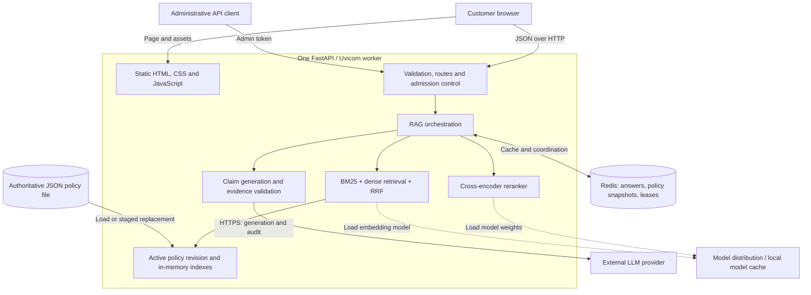

# NovaCart / RAG-with-Redis — System Architecture

**Repository:** [NETSADOM/RAG-with-Redis](https://github.com/NETSADOM/RAG-with-Redis)  
**Source revision:** `fb8791d2196545cb47fa691dd9eda65c4cf11515` (`main` inspected on November 12, 2026)  
**Application version:** `2.1.0`  
**Document basis:** Static inspection of application code, configuration, tests, evaluation scripts, and CI. No running deployment, live model quality, throughput, or test results were independently verified for this document.

## 1. Purpose and scope

NovaCart is a policy-grounded customer-support application. A customer asks a question, the system retrieves relevant policy passages, and a language model produces an answer supported by numbered citations. Redis stores eligible answers so repeated questions can avoid retrieval and generation.

The implementation is a single-process Python application with a browser interface, a local JSON policy store, in-memory retrieval indexes, an external Redis service, and an external language-model provider. It is a modular monolith rather than a collection of independently deployed microservices.

The inspected knowledge base contains **7 policy documents and 14 manually authored chunks**, covering returns, shipping, cancellation, damaged or missing goods, payments, account security, and warranties. These are policy descriptions; the application does not access customer accounts, look up orders, process payments, cancel orders, or create support tickets.

### Implemented boundaries

| Capability | Current implementation |
| --- | --- |
| User interface | Plain HTML, CSS, and JavaScript served by FastAPI |
| API | Synchronous FastAPI handlers with Pydantic request validation |
| Retrieval | BM25 plus normalized embedding similarity, fused with reciprocal rank fusion |
| Reranking | Local cross-encoder with fallback to retrieval order |
| Generation | External OpenAI-compatible chat-completions HTTP API |
| Verification | Deterministic evidence checks followed by a separate LLM audit call |
| Answer reuse | Exact normalized-query cache in Redis |
| Policy authority | Local `backend/data/knowledge_base.json` |
| Policy mutations | Authenticated chunk-text replacement with staged indexes and revision activation |
| Conversation state | Messages displayed in the browser; each API question is independent |

Redis is **not the vector database** in this implementation. Dense embeddings and retrieval indexes reside in Python memory. There is no semantic-answer cache, document-upload pipeline, automatic chunking service, background job queue, or persistent chat-history database.

## 2. System context and deployment boundaries



The local launcher binds to `127.0.0.1:8000` with `workers=1`. The browser and API are served from the same origin. The repository contains CI but no Dockerfile, Compose stack, Kubernetes manifests, reverse-proxy configuration, or automated production deployment.

For a hosted installation, TLS termination, network access controls, persistent storage, process supervision, and provider credentials must be supplied by the deployment environment. These are deployment responsibilities, not implemented repository components.

## 3. Component responsibilities and source map

| Source file | Responsibility |
| --- | --- |
| `run.py` | Starts the single Uvicorn worker on the loopback interface |
| `backend/main.py` | Application lifespan, schemas, public routes, administrative authentication, health responses, static hosting |
| `backend/admission.py` | Per-client fixed-window limiter and nonblocking generation semaphore |
| `backend/locking.py` | Method synchronization and OS-held single-worker file lock |
| `backend/rag/pipeline.py` | Cache coordination, revision snapshots, retrieval orchestration, generation admission, answer eligibility, staged policy updates |
| `backend/rag/retrieval.py` | Policy parsing, revisions, BM25, dense vectors, exact metadata filters, RRF |
| `backend/rag/reranker.py` | Cross-encoder scoring and preservation of the strongest hybrid candidate |
| `backend/rag/generator.py` | Provider configuration, bounded HTTP requests, claim checks, audit, citations and refusals |
| `backend/cache/redis_cache.py` | Redis connections, keys, TTLs, leases, cooldown, snapshots and process-local metrics |
| `backend/data/knowledge_base.json` | Authoritative policy documents and chunks |
| `frontend/public/` | Customer chat, policy browser, evidence dialogs, retry and performance display |
| `backend/tests/` | Unit, API, concurrency, failure-path and optional real Redis tests |
| `benchmarks/` | Retrieval comparison, factual-quality evaluation and pipeline cache/load measurements |
| `.github/workflows/ci.yml` | Deterministic checks and conditionally enabled live-quality gate |

## 4. Application lifecycle

During FastAPI startup:

1. Construct the generator and validate that a provider key and model are configured.
2. Validate the optional support URL and create the request limiter.
3. Acquire an OS file lock at `backend/data/.server.lock`.
4. Construct the Redis cache with `require_connection=False`, permitting degraded startup.
5. Load policy JSON, flatten its chunks, and compute revision identifiers.
6. Build the BM25 index, load the embedding model, and encode the corpus.
7. Construct the hybrid retriever and attempt to load the cross-encoder.
8. Store the shared pipeline in `app.state.pipeline` and serve requests.

The lock remains held for the application lifespan and is released on shutdown or process termination. Redis connections are closed during lifespan cleanup.

Dense-model initialization does not have the same graceful fallback as reranker initialization: a failure to obtain or initialize the embedding model can prevent normal application startup. The pipeline exposes `lazy_dense` for callers such as tests, but the production lifespan does not enable it or expose it as an environment setting.

The file lock prevents two processes from serving the same locked store where OS locking applies. It does not coordinate separate deployments with separate filesystems. Multiple replicas are therefore not a supported scaling strategy for the current policy store.

## 5. End-to-end question flow

```mermaid
sequenceDiagram
    participant B as Browser
    participant A as FastAPI
    participant P as Pipeline
    participant C as Redis
    participant R as Retrieval and reranker
    participant L as LLM provider
    B->>A: POST /api/chat
    A->>A: Validate, authorize bypass if requested, rate-limit
    A->>P: answer_question
    P->>P: Join or create matching in-flight Future
    P->>C: Acquire expiring answer lease
    P->>P: Snapshot revision and indexes
    P->>C: GET exact answer key
    alt Eligible cached answer exists
        C-->>P: Answer, citations and retrieved context
    else Miss or Redis unavailable
        P->>P: Acquire generation slot without waiting
        P->>R: Parallel BM25 and dense search; fuse; rerank
        R-->>P: Up to four selected passages
        P->>L: Generate claims with exact supporting quotes
        L-->>P: Structured claims
        P->>P: Check schema, source membership, quotes and numbers
        P->>L: Audit complete claims against selected context
        L-->>P: Supported flag and unresolved-issue arrays
        P->>P: Build cited answer or refusal
        opt Supported and cache-eligible
            P->>C: SET answer with TTL
        end
    end
    P->>C: Release lease if ownership still matches
    P-->>A: SupportRAGResponse
    A-->>B: JSON answer or error
```

The Redis lease precedes the exact cache lookup on the normal path. Consequently, a cache hit avoids retrieval and generation but is not necessarily a single Redis operation end to end. The answer lookup itself uses one `GET`.

`skip_cache=true` bypasses cache lookup, cache writes, and request coalescing/Redis lease coordination. The HTTP API requires administrative authorization for that option. Generation capacity limits still apply.

### 5.1 Admission and concurrency

The default per-client limit is 20 chat requests per 60-second fixed window. Clients are identified by `request.client.host`. The limiter keeps at most 4,096 active client records and rejects new clients when that capacity is full. Reverse-proxy address handling must preserve the intended client identity if deployed behind a proxy.

Matching questions share a process-local `Future`, keyed by normalized question, active revision, generator model, reranker flag, retrieval limits, and metadata filters. At most 256 distinct in-flight entries are admitted. Followers receive a deep copy of the leader's result; they are not necessarily reported as cache hits.

Redis coordination uses `SET ... NX EX` with a unique ownership token. Release uses `WATCH`, a token comparison, and a transaction to avoid deleting a newer owner's lease. Waiting polls at intervals up to 100 ms. `ANSWER_WAIT_SECONDS`, default 3,000 seconds, controls both waiting and lease duration. A timeout or Redis failure allows independent computation, subject to capacity.

The generation semaphore defaults to two concurrent executions and covers retrieval, reranking, generation, and subsequent work inside that block. It rejects excess work immediately instead of queuing it. Cache hits do not acquire this semaphore.

Lease expiry, eviction, administrative cache clearing, or coordination timeout can allow duplicate computation. This is duplicate-work suppression, not exactly-once execution.

## 6. Retrieval and evidence selection

### 6.1 Knowledge-base representation

The JSON root contains company metadata and a `documents` list. Each document contains `doc_id`, title, version, source reference, and chunks. The loader flattens those records into `KBChunk` objects with these fields:

| Field | Meaning |
| --- | --- |
| `chunk_id` | Chunk identity used for fusion, generation references and citations |
| `doc_id` | Parent document identity |
| `title`, `section` | Human-readable context and search features |
| `text` | Authoritative passage content |
| `source_ref`, `page_number`, `source_url` | Evidence provenance |
| `doc_version` | Parent document's declared version |

Each document receives the first 12 hexadecimal characters of a SHA-256 hash of its sorted JSON representation. A sorted document-revision manifest is hashed to produce a 16-character collection revision. `version_hash` aliases that collection revision. Revision lookup during a question is an in-memory operation.

The collection revision is derived from document content, not from the root `version` or `last_updated` fields. Updating a chunk through the API changes its content hash but does not automatically increment the declared document version or root timestamp.

### 6.2 Keyword and dense branches

BM25 uses `k1=1.5` and `b=0.75`, indexing chunk text plus title. It tokenizes English letters, numbers and dollar-sign tokens, removes stopwords, and scores the corpus in memory. Limited typo expansion applies only to unknown alphabetic tokens of at least four characters when exactly one vocabulary term matches an allowed single-edit or adjacent-transposition pattern. Numbers are not corrected.

Dense retrieval defaults to `all-MiniLM-L6-v2`. It encodes `title: text`, normalizes embeddings, stores a NumPy `float32` matrix, and ranks normalized query vectors by dot product. This is an exhaustive in-memory similarity search, not an approximate-nearest-neighbor index. An encoding lock protects shared model use.

The two branches run concurrently on a shared four-thread search executor. The default candidate limit is 50 per branch. Keyword results with scores of zero or below are removed. Exact metadata constraints are applied to each branch's returned candidate list before fusion.

Supported filters are `doc_id`, `section`, `doc_version`, and `page_number`. They are explicit equality constraints; the system does not infer filters from natural language. Because filtering occurs after each branch's top-k selection, selective filters can miss relevant chunks outside that initial pool as the corpus grows.

### 6.3 Fusion, reranking and final selection

Reciprocal rank fusion adds each candidate's contributions from the two ranked lists:

```text
RRF(chunk) = sum(1 / (60 + rank_in_branch))
```

Candidates present in only one branch remain eligible. The fused records retain keyword/semantic ranks and scores for evidence inspection. The pipeline keeps up to 50 fused candidates before reranking.

The default cross-encoder is `cross-encoder/ms-marco-MiniLM-L-6-v2`. It scores query/passage pairs and sorts descending. Model prediction is serialized with a lock. If loading or prediction fails, the original candidate order is retained.

The default final context contains four passages. If the strongest hybrid candidate is absent from the selected reranked passages, selection replaces the last passage with that anchor when possible. This deliberately trades one reranked position for preservation of the hybrid retrieval signal.

When reranking was requested but did not actually produce rerank scores, a valid answer can still be returned, but the pipeline does not cache it under the requested reranked configuration.

## 7. Generation, validation and refusals

Provider selection is ordered: a nonempty Gemini key takes precedence, then a Groq key, then OpenAI-compatible configuration. The application uses Python's HTTP facilities directly rather than a provider SDK. Requests target `/chat/completions` and request JSON-object output with at most 1,600 completion tokens.

Each call has a 20-second HTTP timeout and a 128 KiB response-size limit. Redirects are disabled. Provider endpoints must use HTTPS and cannot contain embedded credentials, query strings, or fragments. These limits are per call; they are not a complete end-to-end request deadline.

Generation proceeds through these gates:

1. Build context from selected passages, including provenance and retrieval scores.
2. Ask the provider for one to five claims, each containing exactly `text`, `chunk_id`, and `quote`. Empty claims indicate insufficient evidence.
3. Require nonempty strings, a known source chunk, an exact contiguous quote from its text, claim text of at most 1,500 characters, and no preassigned numeric citation markers.
4. Require every numeric value parsed from a claim to occur in its quote. This is a numeric-set check, not full validation of units, dates, arithmetic, or semantic relationships.
5. Make a separate audit call using the question, claims, and all selected context. Require an exact verdict schema, boolean `supported=true`, and empty `omitted_conditions`, `unanswered_parts`, and `conflicts` arrays.
6. Assign citation numbers on the server, deduplicate sources by chunk ID, and join the claims into the final answer.

The audit is a second call to the configured model/provider, not an independent model family. It can assess only the retrieved context, so relevant omitted passages can still affect answer correctness. Citation checks and model auditing reduce risk but do not constitute a proof of factual accuracy.

Refusal reasons distinguish insufficient evidence, invalid claims/evidence, unsupported numbers, invalid audit output, audit rejection, and provider errors. A clean refusal returns HTTP 200 with `is_supported=false`. A provider-error result returns HTTP 503 and is not cached. Empty context is refused without calling the provider.

## 8. Redis storage, identity and freshness

The default namespace is `cs_rag`. Redis stores JSON values and lease tokens, not embeddings.

| Key pattern | Contents | Lifetime |
| --- | --- | --- |
| `cs_rag:ans:v3:<sha256>` | Answer, cited sources, actual model identity, retrieved context | `CACHE_TTL`, default 86,400 seconds |
| `cs_rag:kb:v1:<revision>` | Immutable policy snapshot with documents and chunks | Same default TTL |
| `cs_rag:lock:<sha256>` | Unique answer-computation owner token | `ANSWER_WAIT_SECONDS` |

Query normalization lowercases, trims whitespace, strips terminal `?!.,;:` punctuation, and collapses repeated whitespace. Different paraphrases normally produce different keys; limited spelling tolerance in retrieval does not make the answer cache semantic.

Answer identity includes the normalized question, collection revision, generator identity, and a hash of retrieval configuration: `hybrid-filtered-v4`, filters, reranker flag, retrieval/final limits, embedding model, and reranker model. Generator identity contains `grounded-llm-v4`, provider model, and a hash of the endpoint. These version constants must be maintained when behavioral changes require cache invalidation.

Only nonempty, supported, error-free answers with citations and successful citation validation are eligible for storage. If reranking was requested, successful reranking is also required. Refusals and provider errors are not cached. A cache write failure does not discard a valid freshly generated answer.

Answer caching is application-managed **cache-aside**: lookup, compute on miss, then store. Reads do not refresh TTL. Policy revision changes make old answer keys unreachable for new queries; old keys expire or are evicted rather than being synchronously deleted.

Redis eviction is server-managed. The repository's example sets `maxmemory 30mb` and `allkeys-lru`; the application does not enforce those settings. Historical server observations in the README are not evidence of a current deployment's policy. Expiring leases can be evicted along with cached data under applicable eviction policies.

Cache clearing scans and deletes the entire application namespace, including answers, snapshots, and leases, and resets local counters. It preserves unrelated namespaces but is not an atomic global reset relative to concurrent requests.

## 9. Policy update consistency

```mermaid
flowchart LR
    Auth[Authorize admin] --> Lock[Hold pipeline revision lock]
    Lock --> Stage[Read JSON and replace target text in staged data]
    Stage --> Index[Build staged revision and replacement indexes]
    Index --> Temp[Write temporary JSON]
    Temp --> Cache[Write new revision snapshot to Redis]
    Cache --> Disk[Atomically replace policy JSON]
    Disk --> Activate[Swap active manager and indexes]
    Activate --> Reply[Return old and new revisions]
```



The API edits one existing chunk's text. It rejects an empty trimmed value or an unknown chunk. BM25 is rebuilt; dense retrieval reuses unchanged text embeddings and encodes only missing text using the existing model.

The pipeline's reentrant lock serializes policy updates and protects revision snapshots taken by new queries. Queries that already captured indexes can finish using the prior revision, including writing an answer under that prior revision's cache identity. New queries after activation use the new revision.

Failure before file replacement preserves the active in-memory revision and original file. A Redis snapshot written before a later file failure can remain orphaned until TTL expiry. The temporary file is cleaned up. A crash after file replacement is recovered by loading that file on restart.

This is an application-managed write-through-style activation sequence, not a distributed transaction between Redis, disk, and process memory. Atomic file replacement should not be confused with a guaranteed power-loss-durable transaction; the code does not explicitly fsync the file and directory.

Redis availability is mandatory for successful policy activation even though ordinary questions and policy browsing can continue without it. Directly editing the JSON while the application is running does not reload its active indexes; use the update API or restart for externally managed changes.

## 10. API contracts

| Method and route | Access | Behavior |
| --- | --- | --- |
| `GET /` | Public | Serves the customer page |
| `GET /public/*` | Public | Static assets |
| `GET /api/health` | Public | Readiness/degradation and provider/cache/reranker state |
| `POST /api/chat` | Public; admin for cache bypass | Returns cited answer, refusal, or service error |
| `GET /api/kb` | Public | Active documents and full chunk content |
| `GET /api/metrics` | Public | Process-local cache counters and timings |
| `POST /api/cache/clear` | Admin | Clears application Redis namespace |
| `POST /api/kb/update-policy` | Admin | Stages and activates new text for one chunk |

FastAPI also provides its default API schema/documentation endpoints, including `/docs`.

Example chat request:

```json
{
  "question": "How long do I have to return an item?",
  "skip_cache": false,
  "use_reranker": true,
  "metadata_filters": {"doc_id": "doc_refunds_returns"}
}
```

Questions must have 1–2,000 characters and must not be blank after trimming. Unknown metadata-filter fields are rejected; page numbers must be at least one. The HTTP API does not expose the pipeline's top-k parameters.

Chat responses include `question`, `answer`, `cache_hit`, `cache_type`, `latency_ms`, `sources`, `citations`, `retrieved_context`, `knowledge_base_version`, `model_used`, `citation_validation_passed`, `is_supported`, `rerank_used`, `error`, `refusal_reason`, and `cache_degraded`. `source_references` aliases `sources`, and the HTTP layer adds `support_contact_url`.

On an exact hit, `rerank_used=false` means reranking did not execute for that request, even when the stored answer originated from reranked evidence.

Example policy mutation body:

```json
{
  "chunk_id": "refunds_returns_c1",
  "new_policy_text": "The complete replacement policy text goes here."
}
```

Chunk IDs allow 1–200 characters; replacement text allows 1–20,000. Success returns chunk/document identifiers, old/new collection revisions, and old/new text.

Authentication accepts `X-Admin-Token` or `Authorization: Bearer <token>`. Comparison uses `secrets.compare_digest`. Missing or known placeholder admin configuration disables administrative actions with 503; invalid credentials return 401. Invalid request schemas normally produce 422, explicit blank/unknown-chunk checks produce 400, rate limiting produces 429 with `Retry-After: 60`, and generation-capacity rejection produces 503 with `Retry-After: 5`.

## 11. Frontend behavior

The browser submits one question at a time with `fetch`, renders text through DOM text nodes, and turns recognized citation numbers into buttons that open evidence dialogs. It also displays policy documents, answer-copy controls, a retry action, and cache performance statistics.

The browser request timeout is 60 seconds. This is much shorter than the default 3,000-second coordination wait. Browser cancellation is not an application-level cancellation mechanism for synchronous backend work, so an abandoned request may continue computing.

The visible message list resembles a conversation, but requests contain only the current question. There is no server-side conversation memory, session context, or history replay. “New conversation” clears the displayed messages.

Unsupported answers show support guidance and optionally a validated HTTPS contact link. The interface does not create a support ticket. Non-2xx API responses are generally displayed as generic errors rather than rendering their full structured response body.

## 12. Configuration and runtime dependencies

The pipeline loads the repository-root `.env` through `python-dotenv`. Existing process environment values take precedence under the default loader behavior. Restart the server after configuration changes.

| Variable | Default / requirement | Purpose |
| --- | --- | --- |
| 
| `CACHE_TTL` | `86400`, positive | Answer and policy snapshot lifetime |
| `ANSWER_WAIT_SECONDS` | `3000`, positive | Coordination timeout and lease duration |
| `MAX_CONCURRENT_GENERATIONS` | `2`, positive | Concurrent uncached pipeline capacity |
| `CHAT_REQUESTS_PER_MINUTE` | `20`, positive | Per-client rate limit |
| `ADMIN_API_KEY` | No usable default | Administrative token |
| `SUPPORT_CONTACT_URL` | Empty | Optional HTTPS support destination |
| `EMBEDDING_MODEL_NAME` | `all-MiniLM-L6-v2` | Local embedding model |
| `RERANKER_MODEL_NAME` | `cross-encoder/ms-marco-MiniLM-L-6-v2` | Local reranker |
|
| `GEMINI_MODEL` | `gemini-3.1-flash-lite` in code | Gemini model; deployment should choose explicitly |
|

These model defaults describe the inspected code, not a verification of current provider availability. Avoid configuring unused provider keys because precedence can silently select a different provider than intended.

The project targets Python 3.12 in CI. Runtime dependencies are pinned in `requirements.txt`: FastAPI, Uvicorn, Pydantic, python-dotenv, sentence-transformers, PyTorch, NumPy, and redis-py. Test dependencies are in `requirements-dev.txt`, which includes the runtime file and adds pytest, fakeredis, and httpx. The README's statement that one requirements file installs both runtime and test dependencies differs from the inspected manifests.

Local setup from a checkout:

```powershell
python -m venv .venv
.\.venv\Scripts\Activate.ps1
python -m pip install -r requirements-dev.txt
# Configure the root .env and start/provision Redis separately.
python check_redis.py
python run.py
```

The connectivity check requires Redis; the web application can still start in degraded cache mode. Retrieval model weights are loaded from the local model cache first and downloaded if necessary. The policy directory must be writable for the lock file and administrative updates.


## 13. Capacity, trade-offs and future changes

The design suits a small, curated policy corpus and a single application instance. Dense vectors require approximately `4 × chunk_count × embedding_dimension` bytes for the float32 matrix, excluding models, Python objects, temporary arrays, and indexes. Search scores the corpus and sorts results; corpus growth increases CPU and memory demand.

Typical uncached supported answers require two sequential provider calls, plus retrieval and reranking. Cache reuse therefore saves both local computation and remote generation. Exact-match caching is conservative and easy to invalidate, but paraphrases require new work. Collection-wide revisions simplify freshness at the cost of invalidating unrelated answers after a single policy edit.

Staged updates preserve coherent query snapshots but rebuild indexes while holding the pipeline lock. Large corpora would make updates more disruptive. Shared-model locks and the generation semaphore constrain throughput before horizontal replication is considered.

The following are **proposed extensions, not existing behavior**:

| Priority | Change | Architectural reason |
| --- | --- | --- |
| Before multiple replicas | Move authoritative policies to a shared versioned store; coordinate revision publication and index loading | Independent files and process-local revisions can diverge |
| Before large-corpus use | Introduce ingestion validation, stable chunk identities, token budgets, and a scalable vector index | Current loading and exhaustive retrieval are designed for a small corpus |
| Before private/customer-specific content | Add identity, authorization, tenant-aware retrieval and cache keys | Current corpus and cached answers are shared publicly |
| Operational hardening | Align browser/proxy/server deadlines and add cancellation-aware work management | Coordination waits currently exceed browser timeout |
| Operational hardening | Add request tracing, durable metrics, refusal/error counts, and measured latency percentiles | Current counters omit some traffic and mix timing scopes |
| Policy governance | Add version history, audit records, rollback and concurrent-edit checks | Current update API overwrites one chunk without a durable history |
| Quality improvements | Broaden evaluation data and human review of omissions/conflicts | Model audit and regex checks do not guarantee complete correctness |

## 14. Source references

All links below are pinned to the inspected commit so this document remains traceable if `main` changes.

- [API and lifecycle](https://github.com/NETSADOM/RAG-with-Redis/blob/fb8791d2196545cb47fa691dd9eda65c4cf11515/backend/main.py)
- [Pipeline and policy activation](https://github.com/NETSADOM/RAG-with-Redis/blob/fb8791d2196545cb47fa691dd9eda65c4cf11515/backend/rag/pipeline.py)
- [Retrieval and knowledge-base revisions](https://github.com/NETSADOM/RAG-with-Redis/blob/fb8791d2196545cb47fa691dd9eda65c4cf11515/backend/rag/retrieval.py)
- [Reranking and context selection](https://github.com/NETSADOM/RAG-with-Redis/blob/fb8791d2196545cb47fa691dd9eda65c4cf11515/backend/rag/reranker.py)
- [Generation and evidence validation](https://github.com/NETSADOM/RAG-with-Redis/blob/fb8791d2196545cb47fa691dd9eda65c4cf11515/backend/rag/generator.py)
- [Redis caching and recovery](https://github.com/NETSADOM/RAG-with-Redis/blob/fb8791d2196545cb47fa691dd9eda65c4cf11515/backend/cache/redis_cache.py)
- [Admission controls](https://github.com/NETSADOM/RAG-with-Redis/blob/fb8791d2196545cb47fa691dd9eda65c4cf11515/backend/admission.py) and [worker locking](https://github.com/NETSADOM/RAG-with-Redis/blob/fb8791d2196545cb47fa691dd9eda65c4cf11515/backend/locking.py)
- [Policy corpus](https://github.com/NETSADOM/RAG-with-Redis/blob/fb8791d2196545cb47fa691dd9eda65c4cf11515/backend/data/knowledge_base.json)
- [Browser behavior](https://github.com/NETSADOM/RAG-with-Redis/blob/fb8791d2196545cb47fa691dd9eda65c4cf11515/frontend/public/app.js)
- [CI workflow](https://github.com/NETSADOM/RAG-with-Redis/blob/fb8791d2196545cb47fa691dd9eda65c4cf11515/.github/workflows/ci.yml), [tests](https://github.com/NETSADOM/RAG-with-Redis/tree/fb8791d2196545cb47fa691dd9eda65c4cf11515/backend/tests), and [evaluation tools](https://github.com/NETSADOM/RAG-with-Redis/tree/fb8791d2196545cb47fa691dd9eda65c4cf11515/benchmarks)
- [Runtime dependencies](https://github.com/NETSADOM/RAG-with-Redis/blob/fb8791d2196545cb47fa691dd9eda65c4cf11515/requirements.txt), [development dependencies](https://github.com/NETSADOM/RAG-with-Redis/blob/fb8791d2196545cb47fa691dd9eda65c4cf11515/requirements-dev.txt), [launcher](https://github.com/NETSADOM/RAG-with-Redis/blob/fb8791d2196545cb47fa691dd9eda65c4cf11515/run.py), and [Redis configuration example](https://github.com/NETSADOM/RAG-with-Redis/blob/fb8791d2196545cb47fa691dd9eda65c4cf11515/redis.conf.example)
